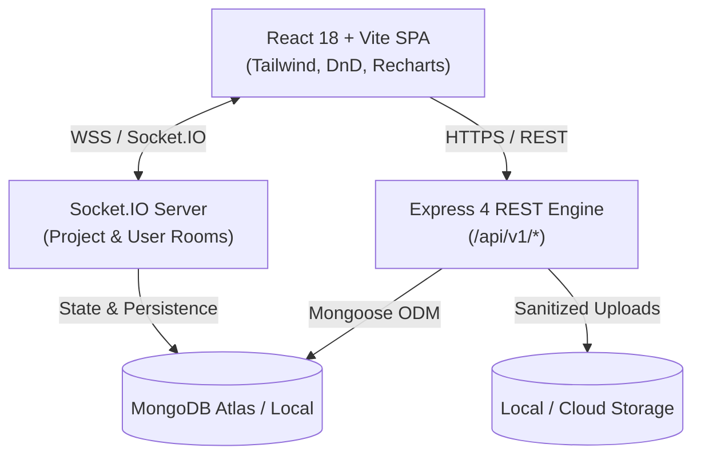
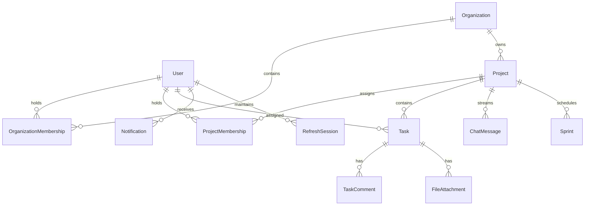

# CollabFlow System Architecture & Technical Specifications

## 1. System Overview

CollabFlow is architected as a modular, real-time collaborative SaaS platform built with React, Node.js/Express, MongoDB, and Socket.IO.

---

## 2. Security & Multi-Tenancy Architecture

### Organizational Boundaries
CollabFlow enforces strict organizational and project boundaries at the database query level:
- Users only access projects in organizations they belong to.
- Private projects require explicit `ProjectMembership` or Project Manager permissions.
- Changing an ObjectId in client URLs is verified against user membership before any query execution (IDOR prevention).

### Authentication Strategy
- **Access Tokens**: Short-lived (15 minutes), signed with `JWT_ACCESS_SECRET`.
- **Refresh Sessions**: 7 days, stored in MongoDB with SHA-256 hashed token (`tokenHash`) to allow immediate revocation.
- **Cookies**: HTTP-only, `SameSite=Lax`, secure in production.
- **Password Hashing**: Salted bcrypt hashing with 10 rounds.
- **Password Reset & Invitations**: Cryptographically secure 256-bit entropy tokens (`crypto.randomBytes(32)`), stored only as SHA-256 hashes with 1-hour/7-day expirations.

### CSV Formula Injection Protection
To prevent CSV Formula Injection exploits (CSV Injection), text cells starting with `=`, `+`, `-`, `@`, `\t`, or `\r` are sanitized by prefixing with an apostrophe `'` before streaming to clients.

---

## 3. Role-Based Access Control (RBAC) Matrix

| Operation | Admin | Project Manager | Team Member | Viewer |
|---|:---:|:---:|:---:|:---:|
| Access Admin Dashboard | ✅ | ❌ | ❌ | ❌ |
| Suspend / Activate Accounts | ✅ | ❌ | ❌ | ❌ |
| Create Projects | ✅ | ✅ | ✅ | ❌ |
| Edit Project Settings | ✅ | ✅ | ❌ | ❌ |
| Archive / Restore Projects | ✅ | ✅ | ❌ | ❌ |
| Invite Members to Workspace | ✅ | ✅ | ❌ | ❌ |
| Create / Assign Tasks | ✅ | ✅ | ✅ | ❌ |
| Move Kanban Cards | ✅ | ✅ | ✅ | ❌ |
| Comment & Upload Files | ✅ | ✅ | ✅ | ❌ |
| Project Chat | ✅ | ✅ | ✅ | ❌ |
| View Boards, Sprints & Reports | ✅ | ✅ | ✅ | ✅ |

---

## 4. Database Models & Indexes

### High-Performance Compound Indexes:
- `Task`: `{ project: 1, status: 1, order: 1 }` (Kanban column fetching)
- `Task`: `{ project: 1, assignee: 1 }` (workload & assignment queries)
- `Task`: `{ assignee: 1, status: 1 }` (personal task list)
- `Task`: `{ project: 1, dueDate: 1 }` (calendar event queries)
- `ChatMessage`: `{ project: 1, createdAt: -1 }` (chat history cursor pagination)
- `Notification`: `{ recipient: 1, isRead: 1, createdAt: -1 }` (notification bell badge)
- `Project`: `{ organization: 1, key: 1 }` (project key uniqueness)

---

## 5. Future Analytics Architecture

The modular design separates business logic in `server/src/services/reportService.js`, with CSV stream generation isolated from Express route handlers. This provides a direct integration point for a future Python/FastAPI microservice to consume task completion event streams and compute advanced ML burndown forecasts without altering core platform models.
